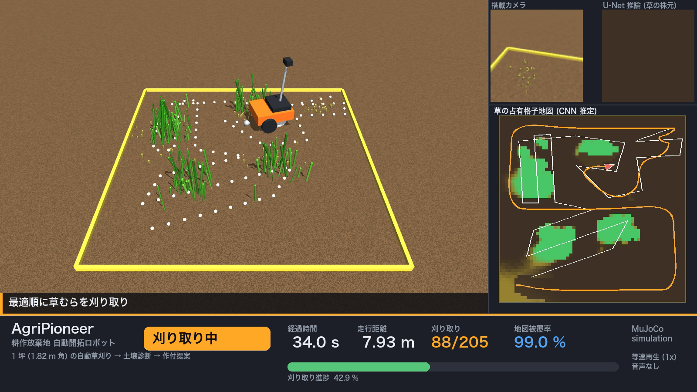
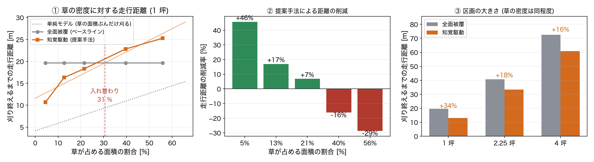

# AgriPioneer — 耕作放棄地を自動で開拓する草刈りロボット

Physical AI 応用1 講座 最終課題 / omnicampus アカウント ID: **142210**

1 坪 (1.818 m 角) の区画に無造作に生えた草を、**単眼カメラ + CNN で地図を作り、
最適経路を計算して刈り切り、そのまま土壌を診断して最適な作付を提案する**まで
を MuJoCo 上で一貫してシミュレーションする。



---

## 1. 背景と目的

日本の第一次産業は後継者不足にあり、同時に少子高齢化・人口減少によって
利用されない土地が増え続けている。この 2 つは「農地として使える土地はあるが、
整備して作付けできる人手がない」という形で表裏一体になっている。

そこで本課題では、**「ロボットを置くだけで土地が農地になる」**という将来像の
第一歩として、以下を自動化した。

1. 区画を見回って草の分布を把握する (**知覚**)
2. 最小の走行距離で全ての草を刈り取る (**計画・制御**)
3. 土を測り、その土地に合った作物を提案する (**診断・推論**)

ロボットは芝刈り機型の差動二輪車とし、刈り取りが終わった時点で
「耕耘して作付けできる状態」になることをゴールとする。

## 2. システム構成

```
          ┌──────────────┐  RGB 96x96   ┌─────────────────┐
          │ 搭載単眼カメラ │ ───────────▶ │ U-Net (0.39 M)  │  ← 学習済み
          │ 高さ0.52m 俯角42° │             │ 草の株元セグメント │
          └──────────────┘              └────────┬────────┘
                                                 │ 確率マップ
                                      平面ホモグラフィで地面へ逆投影
                                                 ▼
    ┌──────────────┐   占有格子    ┌──────────────────────────┐
    │ 占有格子地図   │ ◀───────────│ log-odds 積算 (距離重み付き) │
    │ 61x61 @3cm    │              └──────────────────────────┘
    └──────┬───────┘
           │ 連結成分でクラスタ化 → PCA 主軸に沿った牛耕式被覆
           │ クラスタ巡回順と各経路の向きを TSP (焼きなまし + 2-opt) で最適化
           ▼
    ┌──────────────┐   v, ω    ┌───────────┐   車輪角速度   ┌──────────┐
    │ Pure Pursuit │ ────────▶ │ 差動二輪変換 │ ───────────▶ │  MuJoCo  │
    └──────────────┘           └───────────┘                └──────────┘
           ▲                                                      │
           └──────────────── 姿勢フィードバック ─────────────────────┘

    刈り取り完了後 → 5 地点で土壌計測 → 勾配ブースティング分類器 → 作付提案
```

### 使用している AI

| # | 役割 | 手法 | 学習 |
|---|------|------|------|
| 1 | 草の株元セグメンテーション | 小型 U-Net (PyTorch, 0.39 M params) | MuJoCo 自動生成の合成データ 4,032 枚で学習 |
| 2 | 被覆経路の巡回順最適化 | 焼きなまし法 + 2-opt / Or-opt (向き付き TSP) | 探索 (学習なし) |
| 3 | 土壌から作物の推薦 | HistGradientBoosting 分類器 (10 クラス) | 営農ルールから生成した合成データ 90,000 件を蒸留 |

## 3. セットアップ

Python 3.10〜3.12。

```bash
uv venv --python 3.12 .venv
uv pip install --python .venv/bin/python -e .
```

学習済みモデル (`models/grass_unet.pt`, `models/soil_crop_model.joblib`) は
リポジトリに同梱しているため、すぐに実行できる。

> HUD の日本語描画にヒラギノ (macOS) もしくは Noto Sans CJK を使用する。
> どちらも無い環境ではフォールバックするが、日本語が表示されない。

## 4. 実行

```bash
# 本番ミッション (HUD 付き動画 + 指標 JSON を出力)
python scripts/run_mission.py --out outputs/agripioneer.mp4

# 比較用ベースライン (地図を使わず区画全面を舐める)
python scripts/run_mission.py --mode baseline --out outputs/baseline.mp4

# 区画サイズ・草密度を振った比較実験
python scripts/run_benchmark.py --seeds 3

# テスト
pytest -q

# レポート (PDF) と図の生成
python scripts/make_figures.py
python scripts/make_report.py
```

### ROS 2 で動かす

`simulator / perception / planner / controller` の 4 ノードに分けた構成も同梱しており、
GPU なしの Docker コンテナだけで動作確認できる（詳細は `ros2_ws/README.md`）。

```bash
docker build -t agripioneer-ros -f ros2_ws/Dockerfile ros2_ws
docker run --rm -v "$PWD":/work agripioneer-ros bash -lc '/work/ros2_ws/run_demo.sh 150'
```

実行ログは `docs/ros2_demo.log`。1 坪・草 206 本で刈り取り率 **100 %**（205/205）を確認している。

### モデルを学習し直す場合

```bash
python scripts/gen_perception_dataset.py --worlds 112 --poses 36 --res 96
python scripts/train_perception.py --epochs 16      # CPU 10 スレッドで約 30 分
python scripts/train_soil_model.py                  # 約 1 分
```

## 5. リポジトリ構成

```
src/agripioneer/
├── config.py            全パラメータ (区画 / 草 / ロボット / 地図 / 制御 / シミュレータ)
├── world.py             MJCF の動的生成, 草の生成と刈り取り判定
├── mission.py           SURVEY → PLAN → MOW → VERIFY → SOIL → DONE の状態機械
├── viz.py               HUD 合成 (Pillow) と 3D ビューへの経路重畳
├── perception/
│   ├── camera.py        ピンホールカメラの順投影 / 地面への逆投影
│   ├── dataset.py       MuJoCo からの合成データ自動生成 (ラベルは解析的に計算)
│   ├── unet.py          小型 U-Net
│   ├── runner.py        推論ラッパ
│   └── mapper.py        log-odds 占有格子地図
├── planning/
│   ├── coverage.py      牛耕式探査 / クラスタ分解 / PCA 被覆経路
│   └── tsp.py           向き付き巡回路の焼きなまし最適化
├── control/
│   └── pure_pursuit.py  経路密化つき Pure Pursuit
└── soil/
    ├── field.py         土壌特性の空間場シミュレーション
    ├── crops.py         作物ごとの適性ルール (10 種)
    └── recommender.py   学習済み分類器による推論
scripts/                 データ生成 / 学習 / 実行 / ベンチマーク
ros2_ws/                 ROS 2 Humble パッケージ (Docker で動作確認済み)
tests/                   回帰テスト
models/                  学習済み重み
```

## 6. 結果

詳細は `docs/report/report.pdf`。主な数値は次のとおり。

### 本デモ（1 坪・草 206 本）

| 指標 | ベースライン（全面被覆） | 提案手法（知覚駆動） |
|---|---|---|
| 刈り終えるまでの走行距離 | 19.58 m | **17.03 m** |
| 刈り終えるまでの所要時間 | **64.0 s** | 74.9 s |
| 刈り取り率 | **100 %** | **100 %** (205/205) |
| 草の分布を把握できたか | 0 %（地図なし） | **100 %** |

### 比較実験（全 42 走行、各条件 3 回平均）

走行距離を決めているのは**草が占める面積の割合**で、区画の大きさではなかった。

| 草が占める面積 | 全面被覆 | 提案手法 | 距離の削減 |
|---|---|---|---|
| 4.5 % | 19.65 m | 10.67 m | **+45.7 %** |
| 12.7 % | 19.65 m | 16.30 m | **+17.0 %** |
| 21.4 % | 19.65 m | 18.30 m | **+6.8 %** |
| 39.7 % | 19.65 m | 22.83 m | −16.2 % |
| 55.9 % | 19.65 m | 25.27 m | −28.6 % |

入れ替わり点は被覆率およそ 30 %。**刈り取り率は全 42 走行すべてで 100 %**
（仕上げ巡回で検出しきい値を 0.60 → 0.33 へ段階的に下げる方式による）。

- 知覚モデル（U-Net）検証 IoU **0.781**
- 作物推薦モデル ルール出力との一致率 **89.4 %**（上位 3 件 **99.6 %**）



## 7. 提出物との対応

| 提出物 | 本リポジトリでの場所 |
|---|---|
| 動画 (MP4) | `scripts/run_mission.py` が `outputs/agripioneer.mp4` を生成（等速 1x・約 107 秒） |
| レポート (PDF) | `docs/report/report.pdf` |
| コード一式 | 本リポジトリ全体 |

## 8. 既知の限界

- 土壌の化学特性は MuJoCo では扱えないため、空間相関を持つ合成場で代用している。
  作物適性のルールも一般的な目安を簡略化したものであり、実際の営農判断には
  地域・品種ごとの検証が必要である。
- 草はロボットと物理的に干渉しない静的 geom としてモデル化している
  (刈り取りは刈刃掃引領域との幾何判定)。草をなぎ倒す力学は扱っていない。
- 自己位置はシミュレータの真値を用いている。実機では SLAM / RTK-GNSS が必要。

## 9. ライセンス

MIT
